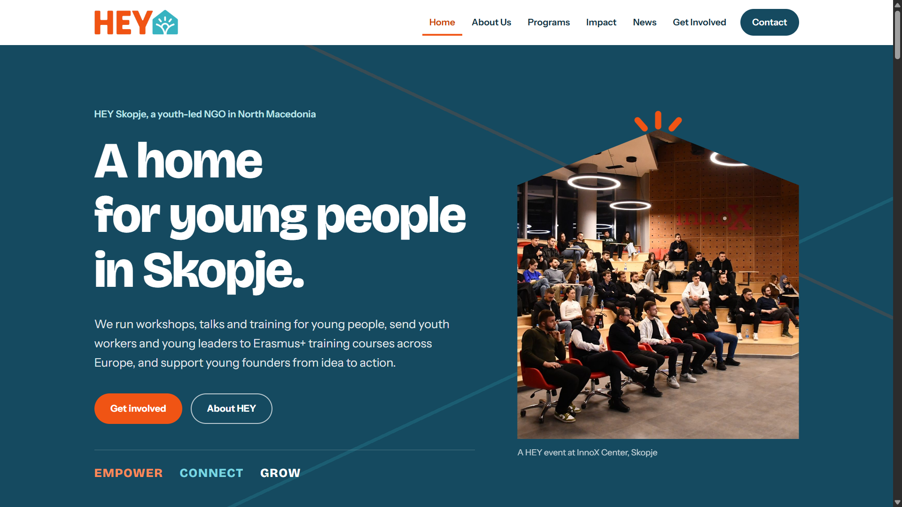
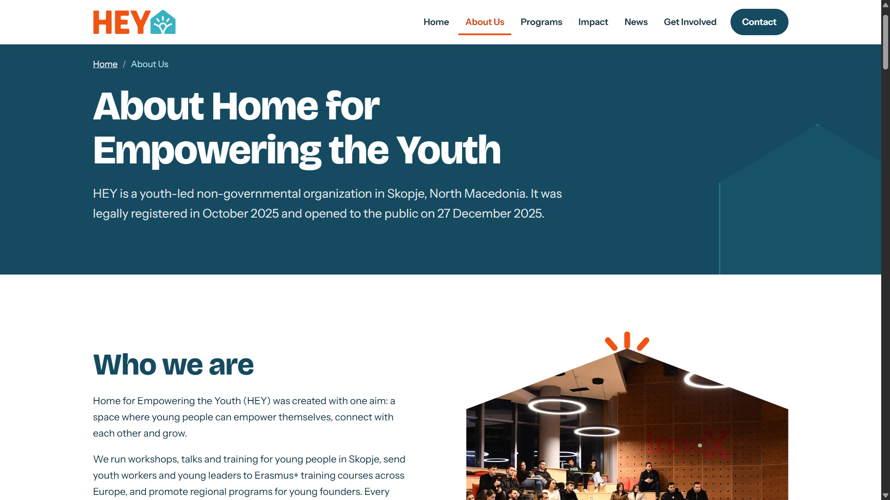
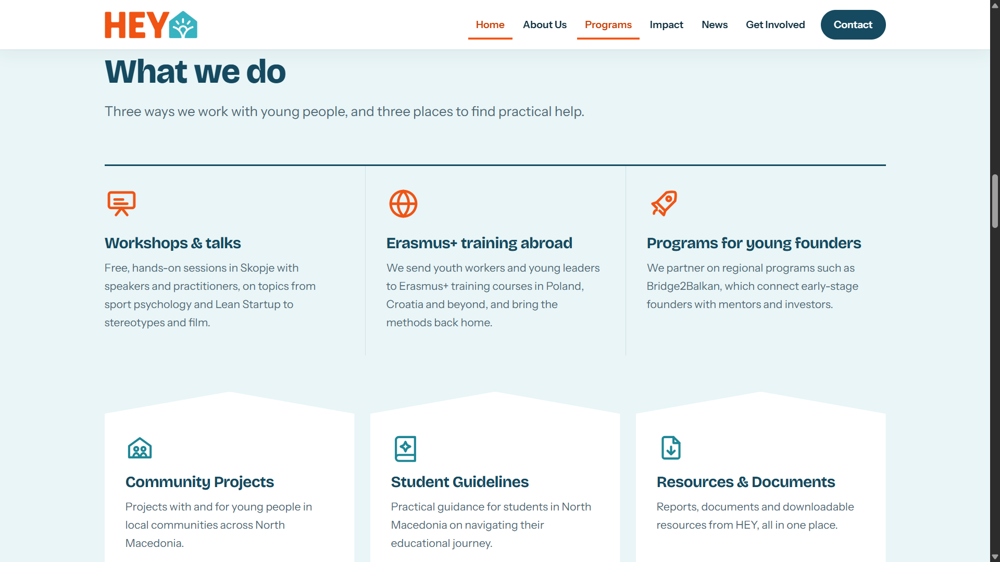
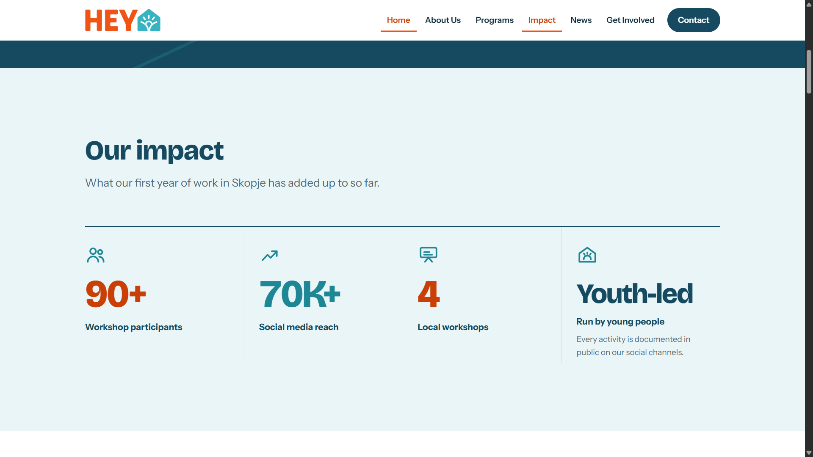
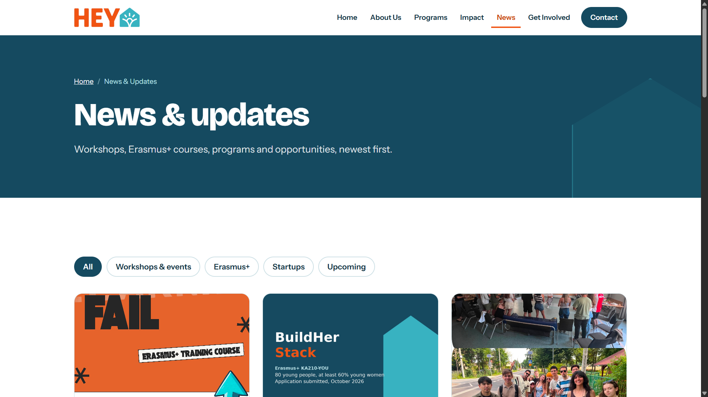

# HEY Skopje – NGO Website

🔗 **Live site:** [heyskopje.com](https://heyskopje.com)

Official website of **Home for Empowering the Youth (HEY)**, a youth-led non-governmental organization in Skopje, North Macedonia that runs workshops, sends young people to Erasmus+ training courses across Europe, and supports young founders.

I designed and built the website on my own, hand-coded without frameworks or a website builder. It is live and used by the organization.

## Tech used

- **HTML5, CSS3 and vanilla JavaScript** with no frameworks, libraries or build step
- **CSS:** custom properties (design tokens for colors, fonts and spacing), CSS Grid, fluid typography with `clamp()`, responsive breakpoints
- **FormSubmit** for the contact and newsletter forms
- **Google Fonts** (Bricolage Grotesque, Instrument Sans)
- **Static hosting** with a custom domain

## Features

- **8 pages plus a custom 404 page:** Home, About, News, article pages, Success Stories, Resources, Student Guidelines and Community Projects
- **Content managed from one data file:** news articles and success stories are stored in `data/content.js`, and the homepage, news list, article pages and success stories page all render from it. Adding a post means adding one entry, with no HTML to edit.
- **One article template for every post:** each article loads by its slug (`/news/post/?id=...`) and sets its own page title, canonical URL and social-media preview tags
- **News filters:** filter posts by category (Workshops & events, Erasmus+, Startups, Upcoming)
- **Contact and newsletter forms:** client-side validation with inline error messages, honeypot spam protection, and submission without a page reload. No API keys or passwords are stored in the code.
- **Interactive touches:** animated impact counters and scroll reveals (using IntersectionObserver), a success stories carousel, and "Get involved" buttons that preselect the topic in the contact form
- **Fully responsive**, with an accessible mobile menu

## Accessibility and SEO

- Skip-to-content link, semantic landmarks, breadcrumbs, and ARIA attributes for the menu, filters, forms and live status messages
- Animations are turned off for visitors who enable "reduce motion" in their system settings
- Content from the data file is HTML-escaped before rendering
- Structured data (schema.org JSON-LD for the NGO), Open Graph tags for link previews, canonical URLs, `sitemap.xml` and `robots.txt`

## Screenshots

| About | Programs |
|-------|----------|
|  |  |

| Impact | News with filters |
|--------|-------------------|
|  |  |

## Note

The source code and content belong to HEY Skopje and are not published here. This repository documents my work on the project.
